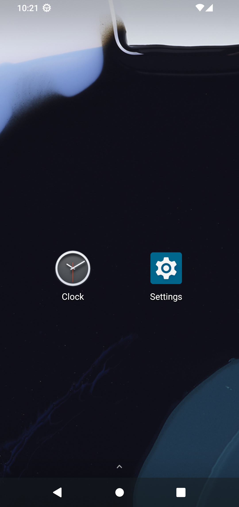
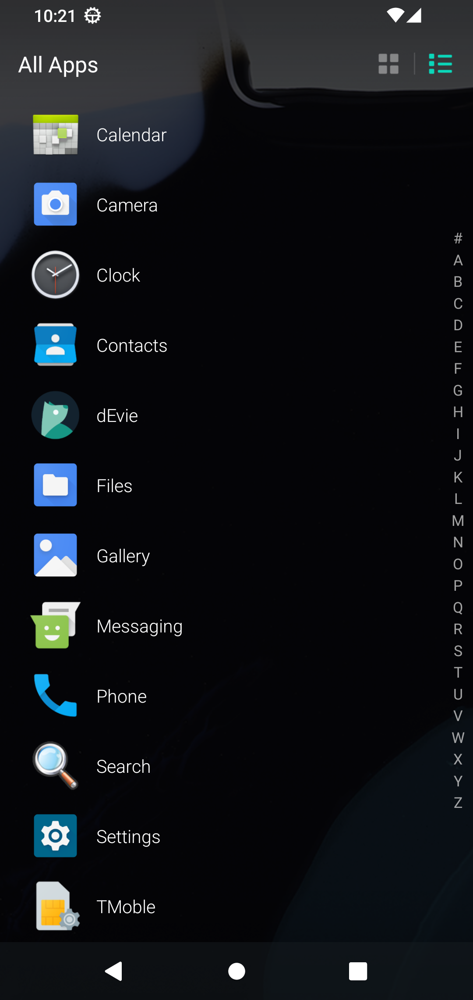
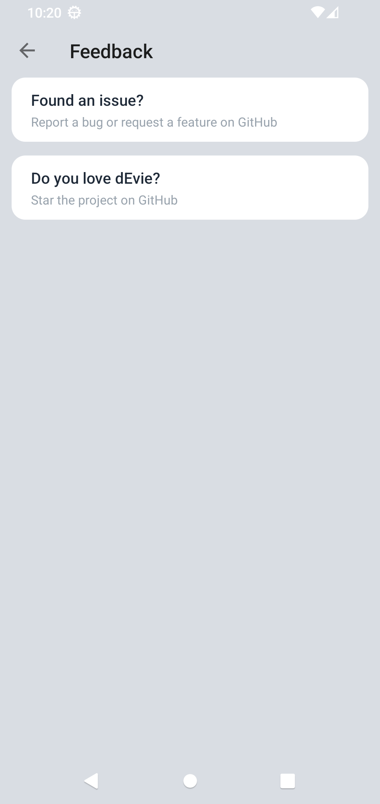

# dEvie Launcher

[]()
[]()
[]()

A lightweight home screen for Android — a ground-up rebuild of Evie Launcher 2.14.8 with
every cloud component removed. Local search, app drawer, dock, badges, app lock and
backup all work fully offline.

| Home | All Apps | Settings → Feedback |
|---|---|---|
|  |  |  |
*(Screenshots from the emulator, `pixel_4` profile, API 33)*

## Why

The original Evie Launcher has been abandoned and its backend servers are gone.
dEvie keeps the parts worth keeping and drops the rest — rebuilt from decompiled
source into a clean, maintainable codebase:

**Kept**

- **Local search** — fuzzy app, settings-deeplink and contact matching, plus a plain
  web-search row that opens in your browser
- **App drawer** — grid or list mode, alphabet scroller, hide-apps filter
- **Homescreen / Dock** — per-surface rows, columns and icon-size sliders, live previews
- **Notifications & unread badges**
- **App lock** (device-admin based)
- **Backup & restore** — local, via the system file picker (SAF), nothing leaves the device
- **Icon packs** (ADW-style theme packages)

**Removed** (all server-dependent)

- News/search feed and side-screen, jigsaw cards, remote "frequently used" predictions,
  analytics/crash reporting, Firebase/GMS extras, the What's-New popup and its promo assets

## Install

Grab the APK from [Releases](https://github.com/icyavocado/devie-launcher/releases)
and install it. dEvie installs **side by side** with your current launcher — you stay in
control of the default assignment via the system dialog. Requires Android 5.0+.

## Build

```sh
./gradlew :app:assembleRelease        # JDK 17, Android SDK 35
```

Release signing expects `keystore/evie-release.properties` with the store/key
credentials (not part of the repo). For a plain debug build: `./gradlew :app:assembleDebug`.

## Privacy

**dEvie doesn't track you.** No analytics, no ads, no accounts, no telemetry of any kind —
the things you do in dEvie never leave your device. The only network touches are icons of
apps you already have, the web-search row (which opens in *your* browser), and this
[terms page](http://www.evie.com/appflash/tc.html) inherited from the original app.

## Feedback

- **Found an issue?** → [open a GitHub issue](https://github.com/icyavocado/devie-launcher/issues)
- **Do you love dEvie?** → [star the project](https://github.com/icyavocado/devie-launcher)

## Credits

Built on the shell of [Evie Launcher](https://play.google.com/store/apps/details?id=is.shortcut)
2.14.8 (its authors created a genuinely great launcher; this project only preserves it).
License: [GPL-3.0](LICENSE).